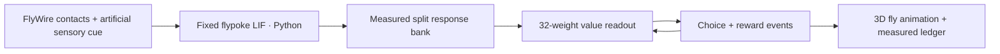

# Money Follows Fly

**Pehchaan first. Paisa later. A fly-connectome reward experiment.**

A real FlyWire-derived neural response bank, a small external learner and an
anatomical 3D fly choosing between immediate and delayed fictional money.
Inspired by Ravi Kishan's “Money follows my brother” line.

**What learns:** 32 external readout weights. **What stays fixed:** the fly
connectivity and neural dynamics. **What moves:** a Flybody mesh with an authored
gait. The browser does not run a whole brain or physical locomotion simulation.

## Try it locally — no installation needed

From the project root, with Python 3.11 or newer:

```bash
python3 -m http.server 8010 --bind 127.0.0.1 --directory frontend/dist
```

Open [the local demo](http://127.0.0.1:8010).

1. Click **Train the readout** for 300 fast training choices.
2. Click **Watch 1 choice** for a slow, frozen test trial.
3. Try **Follow fly** to see the anatomical body up close.
4. Run **Test × 100**, reverse the mapping, or change rewards and delay.
5. Open the methods, compare the measured baselines and export your run.

Ordinary rule changes reset the learner. Reversal retains its weights. Training
uses 20% exploration; frozen tests do not. “Watch 1 choice” never trains. Payout
animations use an accelerated abstract clock, not biological seconds.

The static site includes the measured response bank and web anatomy, so neither
MuJoCo nor a network service is required at runtime. WebGL renders the fly;
the task can still run if 3D rendering is unavailable. Google Fonts is optional
and has system-font fallbacks. Site assets and Three.js are served locally.

## Smallest command-line experiment

The cached learner only needs the Python standard library:

```bash
python3 train.py --seed 0 --episodes 300
python3 train.py --brain mlp --seed 0
python3 train.py --delayed 25 --gamma 0.85 --delay 10
python3 train.py --delayed 25 --gamma 0.85 --delay 5 --no-trace
python3 -m experiments.run_suite --seeds 20 --episodes 300
```

The first command prints choices, money and before/after held-out scores and
writes `results/latest.json`. Default seed 0 measured **49.0% → 99.5%** optimal
test choices. The suite writes both `results/suite.json` and the browser's
`frontend/dist/suite.json`. It takes about 2.3 seconds on the measured arm64 Mac.

Controller names: `connectome`, `random_network`, `mlp`, `fixed`, `random`,
`disconnected`. No real neural bank means an explicit error, never invented data.

## Rebuild the neural data from source

Tested with Python 3.12.14 on macOS arm64. The full pipeline also needs Git and
internet access for dependencies and the approximately 133 MB source files.

```bash
python3.12 -m venv .venv
source .venv/bin/activate
python -m pip install -r requirements.txt
python -m brain.fetch_data
python -m brain.prepare --trials 16
python -m experiments.run_suite --seeds 20 --episodes 300
python -m pytest -q
```

The local build environment for this delivered checkout is `.venv-runtime`.
Its interpreter can run the same commands. It is excluded from source control.

`fetch_data` verifies exact SHA-256 hashes. The connection table is pinned to the
Shiu authors' source commit; annotations are content-hash pinned. A changed
annotation file causes a clear failure and requires resolving that archived
version. Data lives in ignored `data/raw/`; the manifest and response bank retain
the hashes. The Zenodo alternative is not needed for this implementation.

`prepare` joins exact v783 neuron IDs, aggregates contacts, retains directed pairs
with at least five contacts and applies predicted transmitter signs. It runs a
feeding sanity check, then creates separate neural calibration, training, test
and lower-intensity transfer trials. Do not use `--skip-validation` for a bank
you intend to train or publish: the learner requires passed validation.

Measured preparation: 169.7 seconds, 139,248 neurons, 2,700,429 retained pairs.
No GPU was used. Peak RAM was not measured; budget 8–16 GB for rebuilding as an
estimate. The browser only reads a few megabytes of cached features and assets.

## Results — including where it fails

20 learner seeds, 300 training + 200 frozen test choices per seed:

| Controller | Default optimal choices | 120 Hz cue transfer |
|---|---:|---:|
| Connectome + learned readout | 99.38% | 56.98% |
| Shuffled network + learned readout | 100.00% | 100.00% |
| Raw-cue MLP | 100.00% | 100.00% |
| Random / zero frozen readout / disconnected | 51.78% | 50.03% |

**No connectome advantage is demonstrated.** The MLP has direct cue identity,
and only one random graph was used. These are not equivalently trained visual
systems. A weaker cue signal seriously hurts the connectome readout.

After reversing the money mapping and training for 300 more episodes, the
connectome readout averages **30.88%** optimal tests. Only 3/20 seeds reach the
specified rolling recovery criterion. This is not robust reversal learning.

At ₹25 later vs ₹10 now with γ=.85, the correct preference switches from
Pehchaan at five ticks to Paisa at ten. Intact-buffer optimal-choice rates are
91.1% and 99.2%, respectively. Removing delayed cue retention impairs the
delayed-reward mapping. This is an external buffer, not a biological eligibility
trace. All raw summaries are in `results/suite.json`.

## Architecture



The task is a delayed contextual bandit: one choice, then payout. There are no
intervening decisions or navigation policy. The feature vector is retained
externally; normalized LMS fits `G = bonus + gamma**delay * money`. Shared
readout weights score both options. Side invariance is engineered; the fly does
not read the labels. Cached neural trials are resampled with replacement.

## Files

| Path | Role |
|---|---|
| `brain/fetch_data.py`, `brain/prepare.py` | Verified download, ID-safe adapter, validation, response generation |
| `environment/task.py` | Reward timing, reversals and expected returns |
| `training/core.py`, `train.py` | Seeded learning and frozen tests |
| `experiments/run_suite.py` | Baselines, delay, ablation, reversal and transfer |
| `frontend/dist/engine.js` | Matching browser learning algorithm |
| `frontend/dist/arena.js` | Anatomical 3D body and authored movement |
| `frontend/dist/app.js`, `brain-view.js` | Controls, evidence, ledger, activity view and exports |
| `scripts/convert_fly.py` | Rebuild the simplified web anatomy |
| `tests/test_experiment.py` | Invariants and Python/JavaScript parity across all six controllers |
| `docs/RESEARCH.md` | Full A–K research audit, comparisons, methods and launch copy |

## Optional: rebuild the anatomy

This is a presentation asset pipeline, separate from neural preparation:

```bash
git clone https://github.com/TuragaLab/flybody.git research/upstream/flybody
git -C research/upstream/flybody checkout d015e9bfe441bd90ae431bac24c55cb74bdbce26
python -m pip install mujoco==3.3.7 trimesh==4.8.3 fast-simplification==0.1.12
python scripts/convert_fly.py
npm ci --prefix frontend
```

If the upstream checkout already exists, skip cloning it. Conversion preserves
67 articulated bodies and simplifies to approximately 78,000 triangles. The
mesh metadata names its source, license and modifications. No learned Flybody
locomotion controller is bundled. The already vendored Three.js build is 0.180.0;
`npm ci` restores its source package but a normal static preview needs no npm.

## Verification and deployment

```bash
python -m pytest -q
node --check frontend/dist/app.js
node --check frontend/dist/arena.js
python scripts/render_report.py
```

Twelve tests cover reward timing, ablation, held-out seed separation, exclusion
of direct-stimulus neurons from features, immutable evaluation, disconnected
behaviour, Python/JS parity for all controllers and mesh buffer bounds. Node.js
is required for the parity tests. The report renderer uses the `markdown-it-py`
dependency already in `requirements.txt`.

The website is buildless. Its Sites configuration is `frontend/.openai/hosting.json`
and static directory is `frontend/dist`. Deploy the exact tested directory with
that existing Site; keep credentials out of the repository. Other static hosts
can serve the same directory over HTTPS without a backend. Do not use `file://`
because ES modules and fetched JSON require HTTP(S).

A downloadable source bundle is linked in the website methods. It excludes local
environments, raw downloads and hosting credentials. Regenerate it with
`python scripts/package_source.py` after changes.

The full [research report](docs/RESEARCH.md) includes limitations, source links,
all requested repository comparisons, the experiment formulation and social copy.
The browser also offers it as a styled research page.

## Credits

FlyWire FAFB and Shiu et al. supply the data/model foundation; flypoke supplies
the MIT simulator. Flybody anatomy is Apache-2.0 and Three.js is MIT. Their
licenses and conversion notices are included under `frontend/dist/assets/` and
`frontend/dist/vendor/`. No Ravi Kishan audio/video is redistributed.

The new project code is MIT licensed; upstream data/assets retain their own
licenses and attribution. **This V1 uses FlyWire, not MaleCNS.**
