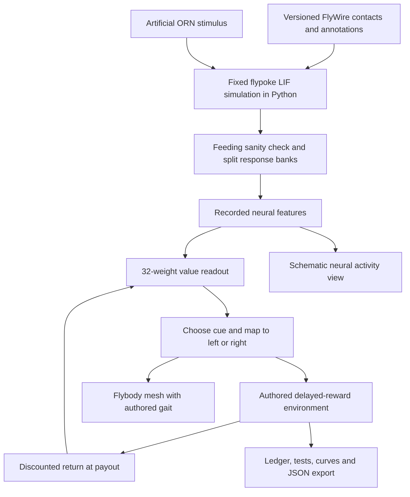

# Money Follows Fly — research, implementation and measured results

Research checked 15–16 September 2026; implementation completed 16 September 2026.

**Recommendation implemented:** a delayed two-choice task using measured activity
from a fixed FlyWire v783 model and **32 trainable external readout weights**.
A detailed Flybody mesh makes the choices visible in a 3D arena. Its walking is
authored animation. This is a computational demonstration, not an uploaded animal,
a trained biological brain, or evidence that flies understand money.

## A. Research summary

### The meme and what makes the experiment work

The source is Raj Shamani's *Figuring Out*, episode FO384 with Ravi Kishan,
released **22 July 2025**. The official episode feed labels **45:19 “Fame vs.
Money.”** Asked to choose recognition or money, Kishan chooses recognition:
“Pehchaan. Money follows my brother.” Recognition/reputation comes first; money
follows it. The experimental hook is the order of events, not understanding the
sentence. [Official episode and chapter list](https://podcasts.apple.com/au/podcast/ravi-kishan-on-politics-childhood-trauma-ego-pm-modi/id1501941375?i=1000718482108).

The older interview became a 2026 meme through short edits, exaggerated
confidence, motivational irony and audience participation. An auditorium video
from MIT ADT University in Pune shows students repeating the line; Kishan later
responded by emphasizing reputation. These reports establish circulation, not
an exhaustive earliest-post chronology. [Pune auditorium report](https://indianexpress.com/article/trending/trending-in-india/ravi-kishan-money-follows-my-brother-college-viral-video-10823654/),
[Kishan's response](https://www.hindustantimes.com/htcity/cinema/ravi-kishan-reacts-to-his-viral-money-follows-my-brother-line-reputation-money-are-101786187486979.html).

Variations include reaction edits, motivational captions and an AI-created
*Friends* crossover. The crossover is an edit, not a real appearance. Some
secondary summaries incorrectly paraphrase the choice as money; the original
recognition-first meaning is the one used here.
[AI crossover coverage](https://www.freepressjournal.in/entertainment/ravi-kishan-in-friends-ai-video-shows-actor-giving-money-follows-advice-to-joey-netizens-react-looks-real-goat-is-everywhere-video).

T-Series announced a song for 11 September 2026. By the research date, its
official catalogue listed *MONEY FOLLOWS MY BROTHER (2026)* and Apple Music's
artist listing showed the released single. Thus “upcoming song” is stale wording
for this report. Detailed credits and popularity counts were not independently
verified. The demo embeds neither the song nor interview audio.
[T-Series catalogue](https://www.tseries.com/),
[Apple Music artist listing](https://music.apple.com/us/artist/ravi-kishan/417977939),
[release announcement](https://www.moneycontrol.com/entertainment/ravi-kishan-s-viral-money-follows-my-brother-meme-turns-into-official-t-series-song-will-release-on-september-11-article-14025113.html).

### MaleCNS: what was released

The complete male central nervous system reconstruction includes the **brain
and ventral nerve cord**, **166,691 neurons** and **11,691 annotated cell types**.
The approximately **125 million synaptic contacts** reported in the accompanying
announcement are not 125 million distinct neuron-to-neuron pairs. Counts depend
on inclusion and filtering rules. The peer-reviewed paper appeared in *Cell* on
3 September 2026. Dataset **v1.0 had already been released on 8 June 2026**;
the September paper is not the first public availability of the data.
[Official project](https://male-cns.janelia.org/),
[release history](https://male-cns.janelia.org/release/),
[Google Research announcement](https://research.google/blog/a-connectomics-milestone-mapping-the-complete-male-fruit-fly-brain/).

The primary paper is Berg et al., *Sexual dimorphism in the complete connectome
of the Drosophila male central nervous system*, *Cell* 189, 5504–5526.e15,
DOI **10.1016/j.cell.2026.08.015**. It enables male/female circuit comparison,
including sex-specific pathways, rather than supplying a complete dynamical
model of behaviour. The preprint DOI is 10.1101/2025.10.09.680999.
[Official publication record](https://research.google/pubs/sexual-dimorphism-in-the-complete-connectome-of-the-drosophila-male-central-nervous-system/),
[PubMed](https://pubmed.ncbi.nlm.nih.gov/41279223/),
[MRC LMB account](https://mrclmb.ac.uk/news-events/articles/first-complete-connectome-of-male-fly-central-nervous-system-allows-for-unprecedented-male-female-brain-comparison/).

MaleCNS provides structural connectivity and annotations, including predicted
transmitter identities. It does not directly measure every synaptic efficacy,
receptor, membrane time constant, plasticity rule or behavioural objective.
Public bulk exports are available without a neuPrint token; authenticated
neuPrint queries are a separate access route. Large connectivity exports are
around gigabyte scale. [Official downloads](https://male-cns.janelia.org/download/).

**FlyWire FAFB differs:** it reconstructs an adult female brain, without the
complete VNC. This V1 uses FlyWire v783, not MaleCNS. Labels and root IDs cannot
be interchanged between their versions or animals.
[FlyWire primary paper](https://doi.org/10.1038/s41586-024-07558-y).

### Three primary modelling papers

| Work | Model and evidence | Consequence for this project |
|---|---|---|
| Shiu et al., *A Drosophila computational brain model reveals sensorimotor processing*, Nature 634, 210–219 (2024), DOI 10.1038/s41586-024-07763-9 | Whole-brain spiking model using connectomic wiring, predicted transmitter signs and shared neuron parameters. Sensory stimulation produces downstream responses; predictions concerning feeding/grooming and sensory convergence are compared with experimental perturbations and recordings. | Strong starting point for sensory propagation. It does **not** establish a reward-learning rule or a whole embodied animal. |
| Lappalainen et al., *Connectome-constrained networks predict neural activity across the fly visual system*, Nature 634, 1132–1140 (2024), DOI 10.1038/s41586-024-07939-3 | Differentiable visual network, tiled retinotopic architecture, passive point-neuron dynamics and rectified graded transmission. Connectivity constrains topology and relative weights; remaining type-shared parameters are optimized on optic flow. Ensemble predictions are compared with visual physiology. | Excellent future sensory frontend if visual input becomes a scientific requirement. Its responses arise from anatomy **and task optimization**, not wiring alone. |
| Vaxenburg et al., Flybody, Nature 643, 1312–1320 (2025), DOI 10.1038/s41586-025-09029-4 | Anatomically detailed MuJoCo body with learned locomotion controllers for walking/flight. | Reuse anatomical geometry for presentation. Running a learned physical gait would be a separate, more expensive extension. |

Primary sources: [Shiu paper](https://doi.org/10.1038/s41586-024-07763-9),
[Shiu data and supplementary archive](https://edmond.mpdl.mpg.de/dataset.xhtml?persistentId=doi:10.17617/3.CZODIW),
[Shiu code](https://github.com/philshiu/Drosophila_brain_model),
[FlyVis paper](https://www.nature.com/articles/s41586-024-07939-3),
[Flybody paper](https://doi.org/10.1038/s41586-025-09029-4).

The Shiu repository contains both v630 and v783 resources. This implementation
explicitly chooses v783. The original Brian2 implementation uses its linear
integration method; flypoke is a separate lightweight numerical implementation,
so bitwise equivalence is not asserted. The paper's supplement includes
behavioural results and sensitivity analyses, including weight perturbations;
these are not a validation of our new reward task. Some publisher/PMC full-text
routes were blocked during the audit; bibliographic records, accessible indexed
paper material, official repositories and available supplements were used.

## B. Existing-project landscape

Repository code and examples were inspected for the main implementation
candidates. The wider landscape below is based on linked project documentation;
its performance statements are author reports, not replications by this project.

### Implementation candidates

| Repository | What it supplies; what was inspected | Decision |
|---|---|---|
| [flypoke](https://github.com/vshapenko/flypoke) | Small MIT NumPy/SciPy simulator. `data.py` handles annotations/sparse graph, `sim.py` implements LIF, `cli.py` supplies selection/stimulation/silencing and verified MN9 IDs. `run(Network, stimuli, Params, seed)` returns spikes and rates. | Reuse unmodified, pinned to `24814fe83224ca2d25c116c1107440b877b07762`. Add a data adapter and an external learner. |
| [Shiu original](https://github.com/philshiu/Drosophila_brain_model) | Brian2 implementation, experiments and original v783 connection table. Its model has fixed wiring, transmitter sign assumptions and an empirical global synaptic scale. | Use its pinned connection table; retain as the scientific reference. Avoid reimplementing all experiments. |
| [ShunyaResearch experiments](https://github.com/ShunyaResearch/drosophila-connectome-experiments) | Brian2 reproduction with neuron queries and sugar-response work. Documented v630 milestone, with v783/body work not all validated. | Useful sanity-check and reproducibility reference. Its runtime/results should not be copied as our own. |
| [FlyVis](https://github.com/TuragaLab/flyvis) | PyTorch differentiable vision. Inspected network/dynamics modules and pretrained-network, moving-edge, custom-stimulus and stimulus-optimization examples. | Defer: abstract cues do not require a visual pathway. |
| [FlyVis tutorial](https://github.com/sjcabs/flyvis_tutorial) | Guided pretrained-model exploration, response embeddings, clustering and gradient-based stimulus optimization. | Future workflow for visual cue robustness; not a reward controller by itself. |
| [Flybody](https://github.com/TuragaLab/flybody) | MuJoCo body, detailed segmented meshes and RL walking/flight examples. Heavy training dependencies are separate from geometry. | User's video steering justified reusing its Apache-2.0 meshes. MuJoCo is needed only to rebuild the converted asset, not run V1. |
| [Fruit Fly Lab](https://github.com/vaibhavkedarisetti/fruit-fly-lab) | Interactive brain simulation with telemetry, silencing and provenance-oriented UI. | Learn from its controls and source labels; do not treat the entire behavioural interface as biologically validated. |
| [FlyBrain](https://github.com/snedea/flybrain) | Browser WebGL point rendering and a worker-based simulator, plus engineered behavioural mappings. Inspected `neuro-renderer.js`, `sim-worker.js`, `fly-logic.js`. | Useful browser architecture. Authored mappings must remain visible in our claims. |
| [fly-brain](https://github.com/lixiang1076/fly-brain) | `dopamine_learning.py` changes active KC→MBON weights with broad reward/punishment multipliers; `fast_learning.py` keeps per-KC valence scores. | Do not copy this as measured dopamine physiology. Timing-, compartment- and receptor-specific biology is missing from a global multiplier. |

FlyVis models roughly 45,669 units in 64 types across 721 retinotopic columns,
with about 1.51 million connections in its tiled architecture. Its pretrained
ensemble, moving-edge probes and maximally exciting stimulus optimization make
sense for questions about vision. They add substantial machinery to a task
whose sensory identity can be specified directly. See the
[primary paper](https://www.nature.com/articles/s41586-024-07939-3) for its
training and validation scope.

### Projects in awesome-fly

The [awesome-fly index](https://github.com/cobanov/awesome-fly) is a discovery
list, not a validation authority. Each project needs its own methods audit.

| Project | Connectome/environment interface | Learning and evidence relevant here |
|---|---|---|
| [Doomfly](https://github.com/nftechie/doomfly) | MaleCNS activity decoded into Doom actions | Fixed readouts and plasticity experiments; its reported KC→MBON learning attempt includes failed validation. It does not justify a general learning claim. |
| [Fly64](https://github.com/ornata/fly) | Sensory/motor interface to Mario | Authored mappings and a simulation-timescale proxy. A whole-body graphic does not establish learned locomotion or game understanding. |
| [Flyhard](https://github.com/MarkUnthank/flyhard) | Connectome-linked steering in a driving-like environment | Author reports an RL pilot using a requested steering angle. Distinguish that interface from learning to drive from pixels. |
| [FlyPong](https://github.com/jonatasperaza/flypong) | Subset of fly network linked to Pong | Reward-modulated plasticity experiments include negative learning findings. A useful warning against equating an update rule with success. |
| [Fly Chess](https://github.com/tolatolatop/fly-chess) | FlyWire activity decoded into chess choices through Rust/WASM | Fixed, untrained readout; game rules and legal actions are external. |
| [fly-craftax](https://github.com/liuzihe02/fly-craftax) | Fixed neural substrate with a PPO-trained downstream controller | Close conceptual prior art for learning outside a fixed connectome; prototype status matters. |
| [Fly Dino](https://github.com/cobanov/flyjump) | Small MaleCNS-derived circuit linked to jump decisions | Current documentation adds a 243-parameter external readout trained with CEM, while its 80-neuron circuit stays fixed. This is additional direct prior art for a small learned readout. |
| [DesktopFly](https://github.com/DenisSergeevitch/desktop-fly) | Desktop embodiment with fly circuit components | Art/interaction and locomotor mappings; a body on screen is distinct from validated sensorimotor closure. |
| [flyverse](https://github.com/tel-0s/flyverse-core) | Hybrid dynamics and an embodied environment | Explicit engineered components and negative controls are valuable. More complex than this V1. |
| [Fly Lab](https://github.com/Apolotary/fly-lab) | Neural activity and a small trained musical/gesture readout | Its documented small readout and authored gestures illustrate why body motion and neural learning need separate descriptions. |
| [Stonkfly](https://github.com/nftechie/stonkfly) | Visual/chart signals decoded into paper-trading actions | Dopamine-inspired updates do not establish reliable learning or profitable finance. Our rupees are fictional reward units. |
| [Fruit Fly Fashion](https://github.com/jtc268/fruit-fly-fashion) | Neural simulation drives visual-art placement and transformations | Creative readout and reproducible art, not evidence that a fly learned aesthetic judgement. |

The user's [video reference](https://www.youtube.com/shorts/BsuCQHeGkxo) was
visually inspected: a rendered fly moves through a rhythm-game scene with neural
activity beside it. That visual presentation is achievable. Its short caption
does not, on its own, establish the details of the learning mechanism. We adopted
the visible body/environment idea and explicitly label our own mechanism.

### Novelty assessment

Searches covered Drosophila connectome reinforcement learning, reward,
delayed reward, temporal difference, value learning, economic/choice tasks,
MaleCNS dopamine/plasticity, the requested repositories and arXiv. Direct Google
Scholar and Semantic Scholar search pages were inaccessible; site-indexed
searches supplemented them. This is a bounded audit, not evidence of absence.

Prior work already combines connectomes and reinforcement learning. For example,
[FlyGM, arXiv:2602.17997](https://arxiv.org/abs/2602.17997) studies fly-derived
graph policies for locomotion and compares graph/topology baselines. It is a
preprint. Fly-craftax and Fly Lab further rule out a broad “first fixed fly brain
with a learned readout” claim.

Fly learning, dopamine timing, value and reward history also have substantial
biological/computational prior work:
[Handler et al., Cell (2019)](https://doi.org/10.1016/j.cell.2019.05.040),
[heterogeneous dopamine models (2021)](https://journals.plos.org/ploscompbiol/article?id=10.1371/journal.pcbi.1009205),
[incentive circuit model (2022)](https://pmc.ncbi.nlm.nih.gov/articles/PMC8975552/),
[reward expectations and operant matching (2023)](https://pmc.ncbi.nlm.nih.gov/articles/PMC10523640/).
These support more careful future plasticity models, not our particular
32-weight rule. Timing-dependent KC/MBON plasticity can have opposite directions;
“reward strengthens every active synapse” is not a sufficient account.

**Defensible contribution:** a culturally legible delayed-reward task, inspectable
controller boundaries, paired controls, downloadable measured data and visible
failure cases. A stronger scientific contribution would require a new hypothesis,
matched topology nulls, independent neural trials, multiple circuit selections
and biological validation. No first-in-field claim is made.

## C. Recommended experiment

Each episode offers two abstract cues, displayed as Pehchaan and Paisa. A single
decision chooses an option. By default, Pehchaan gives one reputation token and
one follower, then ₹100 at tick 5. Paisa gives ₹10 at tick 0. The token reward
weights default to zero; they cannot secretly force the recognition preference.
Every episode has the same abstract horizon, delay + 1 ticks.

The scientific question is: **can a small external learner use fixed neural
responses to fit this reward mapping, and how does it fail under delay,
changed input intensity and reversal?** The measured answer is “yes on the easy
mapping, with poor robustness.” The brain wiring remains fixed throughout.

| Approach | What changes | Permitted claim | V1 decision |
|---|---|---|---|
| A. Fixed connectome + readout | A named external decoder | Learning from fixed connectome-derived features | Implemented; simplest auditable choice |
| B. Dopamine-inspired plastic synapses | Selected modeled KC→MBON or other synapses | Learning in a specified plastic circuit model, subject to biological validation | Defer until compartments, signs, timing and controls are specified |
| C. External RL policy | Policy/readout parameters optimized through reward | An RL agent uses a connectome substrate | Broader family containing A; PPO is unnecessary for this bandit |

Anatomical wiring, assumed dynamics, learned decoder, animated body and authored
reward schedule are five separate components. None should inherit the biological
credibility of the others automatically.

## D. Scientific formulation

| Component | Exact implementation |
|---|---|
| State | Presented cue pair, randomized left/right placement, episode phase and pending payout tick. One action per episode. |
| Sensory input | Two disjoint sets of 128 annotated olfactory sensory neurons, selected with NumPy seed 810. Poisson stimulation at 150 Hz for 250 ms. These are artificial patterns, not natural odours, pictures, speech or words. |
| Neural model | Fixed flypoke LIF dynamics on 139,248 retained v783 neurons and 2,700,429 directed pairs after contact aggregation and a five-contact threshold. |
| Neural parameters | dt .1 ms; rest/reset −52 mV; threshold −45 mV; membrane time constant 20 ms; synaptic time constant 5 ms; refractory 2.2 ms; delay 1.8 ms; global synaptic scale .275 mV. GABA/Glu assumed inhibitory, other predicted classes positive. |
| Features | Top 32 downstream mean-rate neurons selected using calibration responses only. Directly stimulated neurons are excluded. Calibration max scaling followed by per-response L2 normalization. |
| Action | Shared value function scores the two observed feature vectors; selected cue maps to LEFT/RIGHT. Ties are randomized. Position invariance is engineered by this shared decoder. |
| Reward | Scalar fictional money plus optional token reward. Payout probability is 1/.8/.55 for easy/medium/hard, equally applied to both choices. |
| Plasticity | Only 32 external linear weights. No connectome weight, dopamine neuron or biological synapse learns. |
| Algorithm | ε-greedy choice, ε=.2 during training; normalized least-mean-squares update toward discounted episodic return, learning rate .2. Evaluation is greedy with random tie-breaking. |
| Metrics | Held-out optimal-choice rate, pehchaan rate, money, discounted return, expected regret, rolling training rate, reversal recovery and input-intensity transfer. |

With bonus B and cash M arriving at tick d:

```text
G = B + γ^d M
V(cue) = w · x(cue)
w ← w + 0.2 × (G/100 − w·x) × x / max(x·x, 10⁻⁹)
```

The external learner retains the chosen feature until payout. A no-buffer control
removes delayed cash from the learnable return; cash is still counted in the
environment. Immediate bonuses can still update the learner. This ablation
tests an engineered credit-assignment mechanism, not a measured memory trace.
Because there are no intervening actions, this is a **delayed contextual bandit**,
not a demonstration of temporal planning or multi-step TD learning.

The neural and task clocks are separate: 250 biological-model milliseconds per
cached response versus abstract reward ticks. Python completes the event list
within one episode call; the browser replays it and commits learned weights and
totals only after the displayed payout sequence completes. Playback speed has
no effect on reward discounting.

For each graph there are six calibration simulations and 16 trials per cue per
train/test/transfer split. Train seeds begin at 2000; test at 4000; transfer at
6000. Transfer uses 120 Hz. Finite response banks are sampled with replacement:
4,000 held-out choices are not 4,000 independent neural simulations. Calibration
never sees reward labels. Cue/label assignment is counterbalanced by learner-seed
parity; side placement is randomized every episode.

## E. Technical architecture



No live Python server or GPU is needed to use the website. A static ES-module
frontend hosts the response bank, baseline results and locally bundled Three.js.
The simulation adapter is Python/NumPy/SciPy. It consumes the Shiu authors'
v783 table by exact root ID, rather than mixing dataset index conventions.

Why cache? Recomputing hundreds of milliseconds of 139k-cell activity per browser
choice adds latency and operational complexity. Caching makes the live external
learning cheap and inspectable, at the cost of finite sensory variability.
There is no synthetic replacement if the measured response bank is missing.

## F. MVP sequence and compute

1. Audit the biological model and data versions; record the decision before code.
2. Download and hash-check the two source files; build a signed sparse graph.
3. Check spontaneous silence, sugar-driven MN9 activation and bitter suppression.
4. Generate independent calibration/train/test/transfer responses.
5. Run the small CLI learner and six baseline controllers.
6. Run delay, cue-buffer ablation and reversal experiments over 20 learner seeds.
7. Expose the same algorithm in the browser; verify Python/JavaScript parity.
8. Animate the selected choice with Flybody geometry and show all evidence.

All eight steps are implemented. The cached CLI uses Python's standard library;
the full preparation pipeline needs the pinned scientific dependencies. Measured
bank preparation took **169.7 seconds** on this arm64 Mac/Python 3.12 run; the
cached experiment suite took **2.26 seconds**. These timings exclude data
download and asset conversion, and are not cross-machine benchmarks. GPU usage
was zero. Peak RAM was not profiled; 8–16 GB is a planning estimate for rebuilding
the sparse data, not a measured minimum. The deployed static output is about
6–7 MB. Native meshes were simplified for the web.

See the root `README.md` for exact commands and pinned data provenance. The
website works from committed assets without installing MuJoCo. Optional mesh
rebuilding uses MuJoCo only for coordinate resolution and folded-wing posture.

## G. Interactive visualization

The main view puts a recognizable six-legged fly inside an arena. Cyan and lime
reward zones correspond to the randomized choice cards. “Follow fly” gives a
close camera; drag rotates the arena. “Watch 1 choice” runs a frozen test trial,
slow enough to see walking, waiting and payout. “Train” performs 300 choices;
fast and slow playback use the same learning algorithm.

Below the arena, 256 selected neuron identities are drawn in **schematic**
positions. Their displayed rates, spike count and active-neuron count come from
the sampled trial. The graph shows up to 500 strongest retained edges between those
cells. This is not an anatomical reconstruction or live full-brain simulation.

Controls expose controller type, immediate/delayed amounts, delay, discount,
payout probability, seed, token values, cue retention and reversal. Changing
ordinary task settings resets training; reversal preserves learned weights.
The ledger records paid episodes, the graph shows rolling optimal choices, and
before/after evaluations freeze weights. Saved suite results are clearly
separated from the user's current run. Export includes source hashes, seed,
phase configurations, choices and weights.

## H. Repository structure

```text
Fruit Fly Connectome/
├── brain/           # source download, data adapter, LIF preparation
├── environment/     # reward events and expected returns
├── training/        # reproducible RNG, readouts, evaluation
├── experiments/     # baselines, delay/ablation/reversal suite
├── frontend/dist/   # static site, 3D arena, neural view, measured banks
├── data/            # manifest; downloaded raw files ignored
├── results/         # measured validation, individual and suite JSON
├── scripts/         # anatomical asset conversion and report rendering
├── tests/           # scientific invariants and cross-runtime parity
├── docs/            # decision log, research and launch material
├── train.py
├── requirements.txt
└── README.md
```

## I. Exact code and reuse boundaries

| File | Responsibility |
|---|---|
| `brain/fetch_data.py` | Download two public files; verify SHA-256 before replacing local data. |
| `brain/prepare.py` | ID-safe adapter, sparse threshold/sign conversion, feeding check, calibrated features and split response bank. |
| `environment/task.py` | Immutable task configuration, expected return and tick-stamped reward events. |
| `training/core.py` | Shared seeded RNG, 32-weight readout, 33-parameter MLP, training and frozen evaluation. |
| `train.py` | Small runnable terminal experiment and JSON output. |
| `experiments/run_suite.py` | Six baselines, 20 seeds, delay crossover, cue-buffer ablation and reversal. |
| `frontend/dist/engine.js` | Algorithmically matched browser implementation, covered by parity tests. |
| `frontend/dist/app.js` | Experiment state, delayed playback, controls, measured plots and export. |
| `frontend/dist/arena.js` | Rendering of anatomical geometry and authored gait/path. |
| `frontend/dist/brain-view.js` | Sampled recorded rates and edges in a schematic point diagram. |
| `scripts/convert_fly.py` | Simplify and convert upstream Flybody meshes, preserving body hierarchy and source/license metadata. |
| `tests/test_experiment.py` | Timing, reversal, ablation, held-out splits, evaluation immutability, disconnected control, six-engine parity and asset bounds. |

The neural simulator remains upstream code. No FlyVis, PPO, robot control or
claimed biological dopamine mechanism has been quietly added.

## J. Experiment plan and actual results

### Feeding sanity check

Three neural seeds per condition, 1 s simulations and 150 Hz stimulation:

| Condition | Right MN9 mean Hz | Left MN9 mean Hz |
|---|---:|---:|
| No stimulus | 0.00 | 0.00 |
| Sugar | 149.67 | 115.33 |
| Bitter | 0.00 | 0.00 |
| Sugar + bitter | 16.67 | 8.33 |

This validates the expected qualitative sign in this pipeline; it is not a
fresh experimental measurement or an exact replication of every number in the
paper. The two verified MN9 IDs are recorded in `results/feeding_validation.json`.

### Default task: 300 training + 200 frozen test choices per learner seed

20 learner seeds, one anatomy, one randomized graph. ± is standard deviation
across learner seeds, not uncertainty across animals.

| Controller | Test optimal-choice rate | Mean money per test | 120 Hz transfer |
|---|---:|---:|---:|
| Random | 51.78 ± 3.76% | ₹56.60 | 50.03% |
| Raw-cue MLP, 33 parameters | 100.00 ± 0.00% | ₹100.00 | 100.00% |
| Fixed connectome, zero frozen readout | 51.78 ± 3.76% | ₹56.60 | 50.03% |
| Connectome + 32 learned weights | **99.38 ± 0.53%** | **₹99.44** | **56.98%** |
| Randomized network + 32 weights | 100.00 ± 0.00% | ₹100.00 | 100.00% |
| Disconnected downstream signal | 51.78 ± 3.76% | ₹56.60 | 50.03% |

The connectome readout learns the default mapping, but **shows no connectome
advantage**. The fixed zero-weight baseline is deliberately weak and equivalent
to random tie-breaking. The disconnected case analytically replaces downstream
features with zeros; it is not a separately simulated damaged animal. The MLP
sees raw cue identity, so its transfer performance is not a test of sensory
robustness. The random-network null permutes target slots and then coalesces
duplicates; it is not an exact degree-preserving simple-graph rewire. These
controls diagnose a simple learning pipeline, not topology superiority.

### Delay crossover and cue retention

Use ₹25 delayed, ₹10 immediate and γ=.85, so the optimal answer changes with
delay. This prevents “always choose Pehchaan” from passing every condition.

| Delay | Better choice | Intact buffer: optimal tests | No buffer: optimal tests |
|---:|---|---:|---:|
| 0 | Pehchaan | 99.33% | 99.33% |
| 1 | Pehchaan | 99.30% | 24.30% |
| 5 | Pehchaan | 91.10% | 24.30% |
| 10 | Paisa | 99.20% | 75.70% |

At tick 5, 25 × .85⁵ ≈ 11.09, slightly above 10; at tick 10 it is ≈4.92.
The near-tie condition is harder. No-buffer performance shows what the external
cue retention contributes. It does not identify the corresponding biological
memory substrate.

### Reward reversal

After 300 default training episodes, swap the money branches and train another
300 while preserving the weights. Mean frozen-test optimal-choice rate is only
**30.88%**, with **41.74 percentage-point SD**. Only **3/20** seeds reach the
predefined rolling-window criterion of at least 80% optimal choices over 25
episodes, first at 168, 266 or 268 post-reversal episodes.

This is a failure of reliable reversal within the tested budget. A transient
rolling criterion is not sustained recovery. Do not market this as a fly that
adapted robustly. The finite features, linear decoder and reward scaling are
possible contributors; no causal attribution has been established.

### What would justify a stronger study?

Pre-register comparison budgets, several cue selections and shuffled graphs;
add matched random features, a trained-then-frozen readout and matched-input MLP;
generate fresh neural test trials; sweep intensity/noise; analyze feature
conditioning; compare credit-assignment rules at fixed parameter budgets;
repeat on independent anatomy or MaleCNS; then seek physiological predictions.
Select these extensions for a hypothesis, not to hide the current negative result.

## K. Social-media launch

**Project name:** Money Follows Fly.

**README headline:** Pehchaan first. Paisa later. A fly-connectome reward experiment.

**X post:**

> Ravi Kishan: “Money follows my brother.”
>
> Me: gave a virtual fly ₹10 now vs ₹100 later. 🪰
>
> Real FlyWire wiring. Just 32 external weights learn. 3D fly, visible receipts.
>
> 99.4% on the easy test. Reversal? Brother struggled.
>
> The fly understands neither Hindi nor money. [demo link]

**15-second demo script:**

| Time | Screen and caption |
|---|---|
| 0–3 s | Close-up fly, two choices. “Pehchaan ya paisa?” |
| 3–6 s | Fast train; show measured before/after, then “32 external weights learn.” |
| 6–11 s | Watch one frozen choice: fly walks, waits, receives the scheduled reward. “Money follows… after five ticks.” |
| 11–15 s | Show 99.4% default / 57.0% transfer / 30.9% reversal. “Brother has limits. Full controls + code.” |

Use text or original narration. The demo includes no licensed song audio.

**Thumbnail concept:** a large fly in three-quarter view between a lime ₹10 coin
and a cyan Pehchaan marker; headline “MONEY FOLLOWS FLY”; small legible subtitle
“Real wiring. 32 learned weights.” Keep percentages out unless the test condition
is also shown. This is a concept, not a generated thumbnail asset.

**Follow-up 1:** “The random network also got 100%. So no, this doesn't prove fly
wiring is a better learner. Baselines are where the science starts.”

**Follow-up 2:** “Changed the input from 150 to 120 Hz. Success fell from 99.4% to
57.0%. Same wiring, same readout. Robustness is the real test.”

**Follow-up 3:** “We reversed which choice pays. After 300 more episodes, mean
success was 30.9%. Pehchaan ki aadat strong thi. Reversal result included.”

**Follow-up 4:** “The realistic fly is Flybody geometry with an authored gait.
The connectome controller picks the destination. Rendering, motor control and
learning are different jobs.”

Do not use “the first fly that understands money,” “the whole brain learned,”
“conscious digital fly,” “biologically faithful dopamine learning,” or “MaleCNS
demo” for this implementation. The actual implementation is more modest and
more reproducible than those slogans.

## Credits and reproducibility notes

- FlyWire FAFB connectivity/annotations: cite FlyWire and the original authors;
  retain the source data's CC BY 4.0 attribution when redistributing it.
- Shiu table source: commit `91bdd1e7dcf193f3e7ca5a8933497fcef63b7960`.
- flypoke simulator: MIT, commit `24814fe83224ca2d25c116c1107440b877b07762`.
- Flybody anatomy: Apache-2.0, commit `d015e9bfe441bd90ae431bac24c55cb74bdbce26`.
  Meshes were simplified, transformed and converted. The browser gait is new.
  A copy of its license accompanies the asset.
- Three.js 0.180.0: MIT, locally bundled with its license.
- Source file SHA-256 hashes are in `data/manifest.json` and the response bank.
- The annotation URL currently names upstream `main`; its required content hash
  is fixed. If it changes, the downloader fails rather than silently switching
  data. Resolve the archived version before regenerating results.
- Primary-repo source inspection is not the same as running all upstream test
  suites. The local tests target this implementation and the reused neural
  behaviour; Flybody locomotion and FlyVis training were not reproduced.
